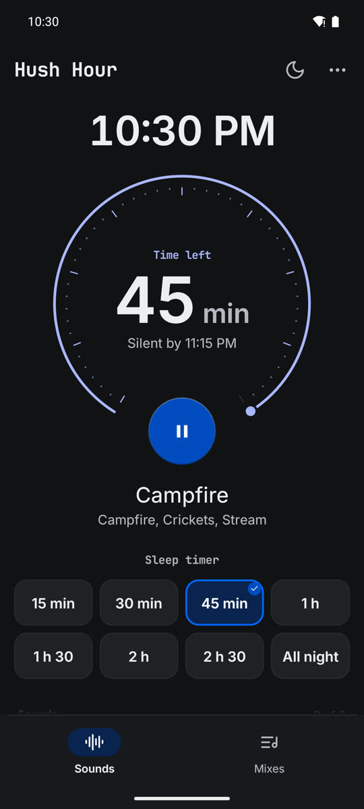

  

<h1 align="center">Hush Hour</h1>

White noise and sleep sounds from real recordings, with a sleep timer that fades out. Pay once, no ads, works offline.

  <a href="https://play.google.com/store/apps/details?id=com.zanoshky.hushhour"><b>Google Play</b></a> ·
  <a href="https://hushhour.zanoski.com"><b>hushhour.zanoski.com</b></a> ·
  <a href="https://zanoshky.github.io/hush-hour-app/"><b>User guide</b></a> ·
  <a href="https://github.com/Zanoshky/hush-hour-app/issues/new/choose"><b>Report a bug</b></a>

  

This repo is the public home for Hush Hour users: the user guide, bug reports and feature requests. The app itself is a paid Android app and its source is not here.

## Quick start

1. Install Hush Hour from Google Play. It runs on Android 7 or newer.
2. Press play under the dial on Sounds. Soft rain on the roof starts, and fades out after 45 minutes.
3. Scroll down and tap sound tiles to mix up to eight sounds, each with its own slider.
4. Pick a timer chip, or All night.
5. Save the mix on Mixes, in the bar at the foot, or start from one of nine ready made ones.
6. Tap the moon to dim the screen to black, and sleep.

## The guide

| Page | What is in it |
| --- | --- |
| [Guide](https://zanoshky.github.io/hush-hour-app/guide.html) | Sounds and Mixes, the timer, More, the widget and Settings |
| [Questions](https://zanoshky.github.io/hush-hour-app/faq.html) | Answers and fixes for common problems |
| [Report a bug](https://zanoshky.github.io/hush-hour-app/report.html) | What to include in a good report |

The guide pages are plain HTML in [docs](docs), built by `python3 build.py`.

## Report a bug or ask for a feature

1. Search the [open issues](https://github.com/Zanoshky/hush-hour-app/issues) first. If yours is there, add a thumbs up or a comment.
2. Otherwise open a [bug report](https://github.com/Zanoshky/hush-hour-app/issues/new?template=bug_report.yml) or a [feature request](https://github.com/Zanoshky/hush-hour-app/issues/new?template=feature_request.yml).
3. Add your app version, phone model and Android version, and a screenshot if you can. Crop out anything private first: issues are public.

## License

The guide text and images in this repo are shared under [CC BY 4.0](LICENSE). The Hush Hour app itself is proprietary and is not covered by this license.
